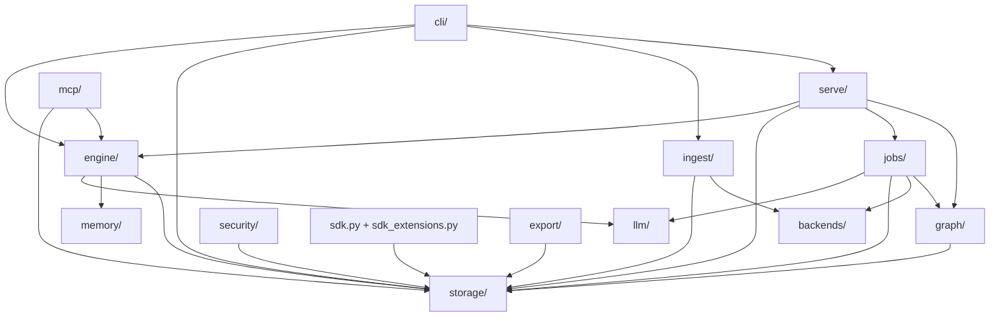
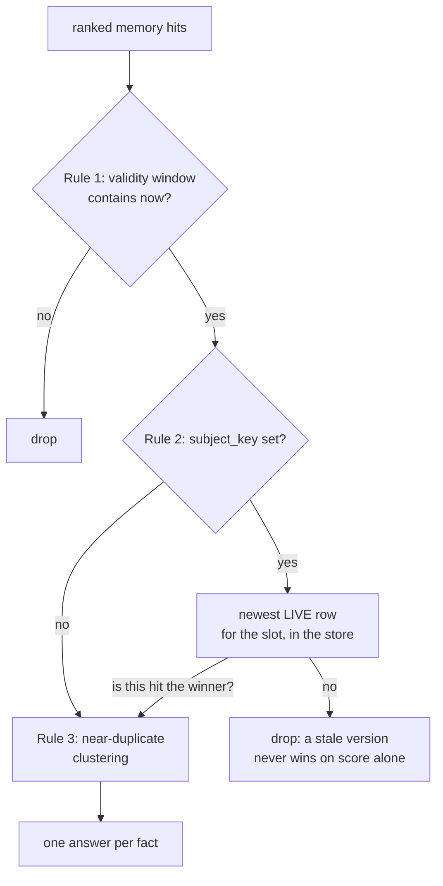
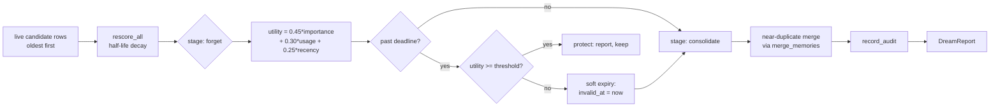
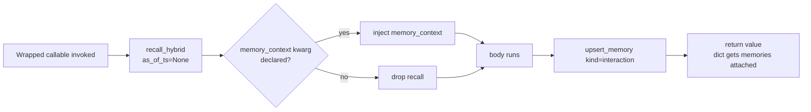
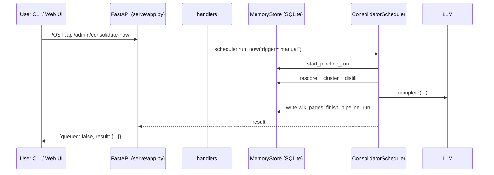

# Architecture

A short map of the codebase so new contributors (and future you) can find their
way around without grepping 8,000 lines of Python.

## Layered view



## Subpackage responsibilities

- **`engine/`** — the core loop. `LoopEngine` drives a turn (read short-term,
  decide what to remember, write to long-term). Pure logic; talks to LLM and
  embedder only.
- **`memory/`** — dataclasses for `MemoryItem`, `WikiPage`, `Entity`, etc. The
  vocabulary of the system.
- **`storage/`** — `MemoryStore`: SQLite-backed persistence. Single source of
  truth for sessions, memories, entities, relations, wiki pages, settings,
  pipeline runs, signals.
- **`backends/`** — pluggable embedders (hashing, sentence-transformers) and
  vector stores (in-memory, Chroma).
- **`llm/`** — `LLMClient` protocol + providers (OpenAI-compatible, Anthropic,
  Ollama, rule-based fallback) and a validated `default_config()` shape.
- **`ingest/`** — convert external transcript formats (Codex, Claude, Hermes,
  generic JSONL) into the common `IngestedSession` and run them through the
  `MemoryPipeline`.
- **`jobs/`** — background work. `Consolidator` (rescore + gc + dedupe),
  `LLMConsolidator` (LLM-driven cleanup), `EvolutionConsolidator` (5-stage
  pipeline), `ConsolidatorScheduler` (APScheduler-based runner), plus v7
  semantic graph scoring and cognitive sleep cleanup.
- **`graph/`** — entity/relation extraction and the read-side `KnowledgeGraph`.
- **`serve/`** — FastAPI app and helpers. `app.create_app()` wires ~40 routes
  to handlers in `handlers.py`. `watcher.py` polls the filesystem for new
  transcripts.
- **`cli/`** — `main.main(argv)` is a 1-line dispatcher; each subcommand lives
  in `cli/commands/` (read / write / serve / hooks / graph / cognitive). The
  positional `export <dir>` form writes a v7 bundle; the legacy `export
  --out <file> [--q <query>]` form remains available.
- **`mcp/`** — stdio MCP server exposing `recall`, `list_wiki`, `get_wiki`,
  `ask`, `inject`, memory write tools, semantic graph tools, and cognitive
  audit tools to the host LLM client.
- **`sdk.py` / `sdk_extensions.py`** — shared in-process and HTTP
  `MemoryClient` contract, namespaces, graph operations, cognitive sleep, and
  portable bundle helpers.
- **`export/`** — white-box `MEMORY.md` bundle export/import and Wiki forks.
- **`security/`** — local secret storage abstraction backed by
  `~/.loop_memory/secrets.json` with mode `0600`.
- **`examples/`** — `demo.py` end-to-end smoke test used by CI.

## The 5-stage evolution pipeline

`jobs.evolution.EvolutionConsolidator` runs the dashboard's main visual loop:

1. **Stage 1 — Signal-Aware Scoring**: blend importance with recall_count and
   feedback, so "what the user actually uses" floats up. When the recall
   query is **1–2 tokens** (`MemoryStore.recall()` `short_query` branch, since
   0.4.4) an extra `recall_count` weight nudges a memory the user has
   surfaced before over a substring-only match, capped at +30 percent.
   3+ token queries are unchanged. See `tests/test_short_query.py` (5 cases).
2. **Stage 2 — Semantic Batching**: greedy cosine clustering into ≤
   `CLUSTER_MAX` buckets (fallback: hashed embeddings).
3. **Stage 3 — Per-Cluster Distillation**: ask the LLM for a 1-sentence
   summary, refined importance, and a keep / drop / rewrite plan.
4. **Stage 4 — Hierarchical Wiki Synthesis**: roll cluster summaries into
   user-profile dimensions (preferences / decisions / projects / domain /
   feedback), merging with existing wiki pages by slug.
5. **Stage 5 — Evolution Memo**: persist what changed so the next run can
   re-prompt with the user's evolving preferences.

The rule-based synthesizer is the safety net: if the LLM is missing or
returns junk, the dashboard still shows real wiki content (with topic-aware
slugs and recorded evidence_ids for drill-down).

### Storage hot paths worth knowing

- `MemoryStore.get_signals(memory_ids)` — batched `memory_signals` fetch
  that replaced the per-id N+1 in the recall path. Called once per
  ranked result page; safe to pass any size (returns a `dict[memory_id]`,
  defaults to zeros for ids that have no row yet).
- `MemoryStore.top_signals(kind, limit)` — top-N by `recall_count` /
  `positive` / `negative`. The dashboard's "most recalled" widget and
  the wiki distillation prioritisation both call this.

### Cognitive sweep observability

`loop_memory/jobs/cognitive.py::cognitive_sleep` is the only job that
may run for minutes on a large store. Each stage writes its elapsed
ms into `CognitiveReportView.stages`; a deadline (`deadline_seconds`)
short-circuits with `aborted=True` + `abort_reason` naming the slow
stage. The HTTP body, the in-process SDK and the CLI all share the
same view — no second JSON shape to maintain.


## Subject keys, latest-only recall + the dream pass (audit 2026-10-25, loop-memory 0.4.16)

### Subject keys — a fact has a slot

A flat memory log cannot answer "what is the current value of X?"
without a second ranking pass over every version. 0.4.16 gives a memory
an optional **subject key**: the logical slot it occupies.

```
memories.subject_key TEXT        -- NULL = standalone fact
idx_mem_subject_key               -- partial index, only keyed rows
```

Two rows sharing `(subject_key, agent_id, user_id)` are two *versions*
of one fact. The write path makes the new row live and supersedes the
previous one:

```sql
UPDATE memories SET superseded_by = :new_id
WHERE id != :new_id AND superseded_by IS NULL
  AND subject_key = :key
  AND ((agent_id IS :agent AND user_id IS :user)
       OR (agent_id IS NULL AND user_id IS NULL AND :user IS NULL))
```

No row is deleted, so `recall_as_of()` still answers "what did we
believe last week?". The content-hash dedup path is slot-aware too —
two *different* slots holding the same text stay two rows, otherwise a
slot would silently swallow another one.

### Latest-only recall

`recall()` / `recall_hybrid()` accept `latest_only=False`. When set,
`_filter_latest_only()` collapses the result in three layers:



Rule 2 looks the winner up **in the store**, not in the candidate list.
That is the important detail: a superseded version must not come back
just because it happened to match the query better than the current one.

The default (`latest_only=False`) is unchanged — the 0.4.15 contract is
"plain recall returns everything unless the caller asks for a validity
window". `latest_only` is the *opt-in* "current truth" view.

### The dream pass

`loop_memory/jobs/dream.py` is the sleep-time consolidation pass. It
is deterministic, zero-dependency and **non-destructive**:



Why utility and not age: "In Defense of Forgotten: TTL-aware Memory
for Long-Horizon Agents" (arXiv 2605.27366) argues that eviction should
be utility-aware. A fact that is old but surfaced every session is worth
more than a fact that is recent but never used. The blend keeps
*importance* dominant, gives *usage* real weight, and uses *recency*
only as a tie-breaker.

Why soft expiry and not DELETE: `cognitive_sleep --apply` deletes stale
rows outright, which destroys the history the audit trail and
`recall_as_of()` depend on. `expire_memory()` stamps `invalid_at`
instead — the row leaves the current view (via `latest_only` or an
explicit validity window) but stays queryable forever.

### Supersession hygiene in the hybrid path

Until 0.4.16 the hybrid recall path did not filter `superseded_by`:
the BM25 channel, the LIKE fallback and the semantic channel all
returned both versions of a superseded fact, contradicting the contract
`recall()` has always had. All three channels now exclude superseded
rows — which is also what makes `latest_only` correct on the path the
CLI, the MCP server and the dashboard actually use.

## Bi-temporal validity + content-hash dedup (audit 2026-10-18, loop-memory 0.4.15)

The `memories` table carries three new columns that turn the store
from a flat log into a time-aware knowledge base:

- `content_hash TEXT` — SHA-256 of normalised text. The
  `idx_mem_content_hash` partial index keeps dedup O(1). New
  `upsert_memory(dedup=True)` collapses byte-identical pushes to a
  single row even when `external_id` is None.
- `valid_at REAL` — epoch the memory becomes active. Defaults to
  `created_at` so existing callers see no behaviour change.
- `invalid_at REAL` — epoch the memory expires. `NULL` means still
  open-ended (the common case); a non-null value softly expires the
  memory without DELETEing it so the audit trail stays intact.

The `validity_clause(as_of_ts)` helper builds the SQL guard:

```sql
AND (m.valid_at IS NOT NULL AND m.valid_at <= ?  -- as_of
     AND (m.invalid_at IS NULL OR m.invalid_at > ?))  -- as_of
```

This is wired into `recall()` (WHERE clause) and `recall_hybrid()`
(post-fusion filter in `_hydrate_memories()`), gated on an optional
`as_of_ts` parameter — when `None`, the legacy "everything" behaviour
is preserved so every existing caller is unchanged. `recall_as_of()`
still walks the supersession chain for the explicit bi-temporal
question "what did we know at time T?"; the new `as_of_ts` is the
cheap "is this memory still in its validity window at time T?"
companion.

### Hybrid recall + evidence chain

```mermaid
flowchart LR
    Q[Query] --> BM25[bm25_search<br/>FTS5 + LIKE fallback]
    Q --> SEM[search_by_embedding<br/>optional]
    Q --> ENT[search_memories_by_entity_names<br/>optional]
    BM25 --> RRF[fuse_rrf_with_channels<br/>k=60]
    SEM --> RRF
    ENT --> RRF
    RRF --> HYDR[_hydrate_memories<br/>+ as_of_ts validity filter]
    HYDR --> EV[evidence:<br/>{field, value, weight}]
    EV --> OUT[RecallHit]
```

`fuse_rrf_with_channels` (audit 2026-10-18) is a strict superset of
the original `fuse_rrf`: same RRF math + per-channel score
breakdown so each hydrated hit carries `evidence: [{field, value,
weight}]` describing which channels contributed. The pre-existing
`fuse_rrf` is unchanged — callers that want the minimal payload
keep using it.

### `@agent_memory` decorator



`loop_memory.decorators.agent_memory(store, agent_id=, limit=)` is
the one-line adoption shortcut. The decorator survives both store
read failures and store write failures — neither can break the
wrapped call.

## Request lifecycle



## Configuration & secrets

- All persistent settings live in the SQLite `settings` table.
- API keys **never** land in that table — they're stored in the local
  `~/.loop_memory/secrets.json` file with mode `0600`, under a per-provider
  account name (`llm/<provider>/api_key`).
- The settings blob carries only `api_key_set: bool` + `api_key_account: str`
  as hints, so the UI can render a "key configured" badge without leaking
  the secret to disk.
- `validate_config()` is the single source of truth for clamping
  `temperature`, `max_output_tokens`, `batch_size`, etc.

## Testing

- **955 tests across 75 files** (955 passed / 4 skipped; all run via
  `pytest -q`), pinned by:
  - 77 new in 0.4.16 — `tests/test_subject_key_2026_10_25.py` (16),
    `tests/test_latest_only_2026_10_25.py` (14),
    `tests/test_dream_2026_10_25.py` (26),
    `tests/test_dream_cli_http_2026_10_25.py` (21).
  - 21 new in 0.4.4 (`tests/test_cli_rules.py` + `tests/test_short_query.py`)
  - cognitive-sleep stages / abort + bulk `get_signals` covered in
    `tests/test_universal_memory.py` (e.g. `test_get_signals_*`,
    `test_cognitive_sleep_*`) and `tests/test_serve_handlers.py`
    (`test_returns_all_six_stages_even_when_empty`).
  - prior releases (`tests/test_universal_memory.py` etc.).
- New code should ship with at least one focused unit test in `tests/`.
- CI (`.github/workflows/tests.yml`) runs ruff + mypy (advisory) + pytest
  with a 60% coverage floor.
